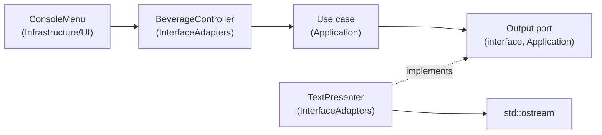

# AGENTS.md

## Project overview

CoffeeShop is a modern C++ (C++20) learning project for managing drink orders. It is laid out
as Clean Architecture and uses classic GoF patterns:

| Layer | Namespace | Headers | Sources | Notes |
|---|---|---|---|---|
| Domain | `coffee_shop::domain` | `include/Domain/` | `src/Domain/` | `Beverages` (`IBeverage`, `Coffee`, `Tea`, ...), `Ingredients` (decorators over `IBeverage`: `Sugar`, `Milk`, ...), `BeverageFactories` (`BeverageFactory`, `IngredientFactory`, `BeverageBuilderSimpleFactory`: plain classes, injected by reference), `BeverageBuilder` (`IBeverageBuilder` interface, `BeverageBuilderBase` with the shared state, concrete builders, `BeverageBuildDirector`) |
| Application | `coffee_shop::application` | `include/Application/UseCases/` | `src/Application/UseCases/` | Use cases (`AddNewOrderUC`, `ListOrdersUC`, `CancelOrdersUC`), their output ports (`IAddNewOrderOutputPort`, `IListOrdersOutputPort`, `ICancelOrdersOutputPort`) and `IOrderRepository` |
| InterfaceAdapters | `coffee_shop::interface_adapters` (`Gateways`: `...::gateways`) | `include/InterfaceAdapters/` | `src/InterfaceAdapters/` | `BeverageController`, `TextPresenter` (implements the output ports, writes text to a `std::ostream`), `OrderRepository`, `Gateways/OrderDiskDataSource` |
| Infrastructure | `coffee_shop::infrastructure::ui` | `include/Infrastructure/UI/` | `src/Infrastructure/UI/` | `ConsoleMenu`: console menus that read the user's choices from a stream (library `ConsoleUi`, grouped in the `Infrastructure` interface target) |
| App | global `main()` | n/a | `apps/ConsoleApp/main.cpp` | `CoffeeShopApp` executable and composition root: creates and wires the factories, `OrderRepository`, `BeverageController`, `ConsoleMenu` and two `TextPresenter`s (screen and `orders.txt`) |

Dependencies point inward: Domain must not include Application, InterfaceAdapters or Infrastructure
headers. Infrastructure (UI) is the outermost layer; menu texts belong there, not in the Domain.

### Flow of a request



- Use cases never print. They report the result through **their own output port**, one per use
  case (`IAddNewOrderOutputPort::orderAdded/orderRejected`,
  `IListOrdersOutputPort::ordersListed`, `ICancelOrdersOutputPort::ordersCancelled`), and pass
  plain data (descriptions as `std::string`, counts), not Domain objects.
- `BeverageController::addOrder(request, outputPort)` / `listOrders(outputPort)` /
  `cancelOrders(outputPort)` create and run the use case; the caller chooses the output port (the
  screen or a file).
- "Cancel orders" cancels **all** current orders (`IOrderRepository::cancelOrders()` returns how
  many there were). Cancelling when there are none is not an error.
- There are no input ports on purpose: the controller calls the use cases directly. That still
  follows the dependency rule (outer layer → inner layer); add input ports only if a use case
  needs to be replaced or faked behind the controller.

### Creating objects and ownership

- No singletons or other global state. Every dependency is passed **by reference to the
  constructor** and kept as a private pointer (see "Code style"). Classes depend on the
  interface when there is one: `AddNewOrderUC` and `BeverageController` take a
  `domain::IBeverageBuilderFactory &`, not `BeverageBuilderSimpleFactory`.
- `main()` is the **composition root**: it creates the factories, the repository, the controller,
  the menu and the presenters, and wires them together. They are local variables declared in
  dependency order, so they are destroyed in reverse order and no object outlives what it
  points to. A new dependency is created there and passed down; nothing below `main()` creates
  its own collaborators.
- `BeverageBuilderSimpleFactory::createBeverageBuilder()` returns a `std::unique_ptr`: the caller
  (`AddNewOrderUC`) owns the builder. `BeverageBuildDirector` gets the builder by reference in
  its constructor and only uses it while building, so a director always has a builder.

### Beverages and ingredient rules

Each `BeverageVariety` has a builder, created by `BeverageBuilderSimpleFactory`.
`BeverageBuildDirector(builder).buildBeverage(ingredients)` adds the requested ingredients in a fixed order
(sugar, milk, honey, lemon, water) and returns `false` as soon as the builder refuses one, or if two
kinds of milk (milk, soy milk, cream) are requested together. A refused ingredient rejects the order.
The table below is tested row by row in
`tests/IntegrationTests/BeverageBuilder/src/BeverageBuildDirectorParameterized_Test.cpp`
(`GivenAnAcceptedOrder` / `GivenARejectedOrder`): when a rule changes, change both.

| Family | Varieties (builder) | Sugar | Milk / soy milk / cream | Honey | Lemon | Water |
|---|---|---|---|---|---|---|
| Coffee | espresso, decaf (`CoffeeBuilder`) | yes | one kind | no | no | no |
| Coffee | latte (`CoffeeLatteBuilder`) | yes | no (it already has milk) | no | no | no |
| Tea | black, green (`TeaBuilder`) | yes | one kind, not with lemon | yes | not with milk | no |
| Cocoa | cocoa (`CocoaBuilder`) | yes | milk or soy milk (no cream) | yes | no | no |

Names in descriptions come from `inline constexpr std::string_view` constants next to each class
(`CoffeeEspressoName`, `SugarName`, ...). Ingredients build their part with
`IngredientDecorator::describeWith(XName)`, e.g. `"CoffeeEspresso, Sugar"`.

The tools are CMake 3.x (≥3.25; the presets file uses format v9, which needs ≥3.30), Ninja, MSVC (Visual
Studio 2022) on Windows and gcc (12 or later) on Linux, Conan **1.x** (GoogleTest 1.14.0), clang-tidy and
clang-format from **LLVM 23**, and pre-commit. `docs/README_development.md` shows the target folder
layout. Of its `Infrastructure` folders only `UI` exists; others it lists (`Infrastructure/DB`,
`libs`, ...) don't exist yet.

## Setup

- **Windows with MSVC, and Linux with gcc.** Other compilers (clang, Apple Clang) aren't tried
  yet. `python scripts/dev.py` (see "Scripts and CI") works on both.
- **Linux:** gcc 12 or later, Ninja, CMake 3.30 or later but 3.x, Conan 1.61.0 and clang-tidy 23.1.4.
  Debian 12 has gcc 12 and Ninja, but only CMake 3.25, and no LLVM 23. Install with `apt` what it
  has, and the rest with **pipx** (Debian blocks `pip install` outside a virtual environment); it
  puts each tool in `~/.local/bin`:
  ```bash
  sudo apt install g++ ninja-build ccache pipx
  pipx install "conan==1.61.0"
  pipx install "cmake>=3.30,<4"
  pipx install clang-tidy==23.1.4
  pipx install gcovr==8.8              # only for the coverage
  ```
  CMake stays on 3.x on every machine: CMake 4 dropped the compatibility with very old minimum
  versions, which files that Conan 1 generates may rely on.
- **WSL on the Windows checkout** (e.g. `/mnt/d/...`) works: each system builds in its own
  `build/<preset>` folder and has its own Conan folder. Run `dev.py` rather than `conan install` by
  hand: it keeps Conan from rewriting `CMakeUserPresets.json` (see "Build").
- **Windows:** `dev.py` sets up the environment by itself. To run CMake by
  hand, use an **x64** Developer environment (x64 Native Tools prompt, or call
  `vcvars64.bat`). The presets use `architecture.strategy: external`, so CMake picks up whatever
  `cl` is on `PATH`. With the x86 `cl` the build fails at link time with
  `LNK4272: library machine type 'x64' conflicts with target machine type 'x86'` against the
  Conan gtest libs. In PowerShell, use
  `& "<VS>\Common7\Tools\Launch-VsDevShell.ps1" -Arch amd64 -HostArch amd64 -SkipAutomaticLocation`
  (the VS "Developer PowerShell" defaults to x86).
- **clang-tidy and clang-format come from LLVM 23**, not from the LLVM 19 that Visual Studio 2022
  bundles. Only those two tools are needed (~100 MB, from the official PyPI packages), in a
  versioned folder outside `Program Files`, pointed at by the **user** environment variable
  `LLVM_TOOLS_DIR`:
  ```powershell
  python -m pip install --target "$env:TEMP\llvm-pkgs" --no-deps clang-tidy==23.1.4 clang-format==23.1.3
  New-Item -ItemType Directory D:\LLVM\23.1.4\bin
  Copy-Item "$env:TEMP\llvm-pkgs\clang_tidy\data\bin\clang-tidy.exe" D:\LLVM\23.1.4\bin\
  Copy-Item "$env:TEMP\llvm-pkgs\clang_format\data\bin\clang-format.exe" D:\LLVM\23.1.4\bin\
  Copy-Item "$env:TEMP\llvm-pkgs\clang_tidy\data\lib" D:\LLVM\23.1.4\lib -Recurse  # clang's built-in headers
  [Environment]::SetEnvironmentVariable('LLVM_TOOLS_DIR', 'D:\LLVM\23.1.4\bin', 'User')
  ```
  Then restart Visual Studio and open terminals (they read the variable at start-up) and configure
  once with `--fresh`. In Visual Studio, also point the editor at the same clang-format:
  **Tools > Options > Text Editor > C/C++ > Code Style > Formatting**, "Use custom
  clang-format.exe", `D:\LLVM\23.1.4\bin\clang-format.exe`. On Linux, install the same version with pipx (see
  above); the CI installs it with pip.
- The build checks the version: CMake (`cmake/clang_tidy.cmake`) looks for clang-tidy in
  `LLVM_TOOLS_DIR`, then on `PATH`, and stops if it isn't LLVM 23; the Visual Studio project stops
  if `LLVM_TOOLS_DIR` is unset or isn't LLVM 23 (see "Visual Studio project"). Before LLVM 23, CMake
  took the first `clang-tidy` on `PATH`: in an x86 environment that was Visual Studio's 32-bit one,
  which crashes (`0xC0000005`) on this project.
- GoogleTest comes from Conan. CMake finds it through the folder Conan writes (added to
  `CMAKE_MODULE_PATH`), so that folder must exist: `build/generators/` with MSVC (one for both
  configurations) and `build/<build type>/generators/` with gcc. `dev.py` runs `conan install` when
  it is missing; by hand (Conan 1.x, `cmake_layout`):
  `conan install . -s build_type=Debug --build=missing`
  On Linux, add `-s compiler.libcxx=libstdc++11`. libstdc++ has two ABIs, and the one named "C++11"
  is gcc's default since gcc 5, for every `-std` (C++20 too). Conan 1 detects the old one, and then
  GoogleTest doesn't link (`undefined reference to ...std::__cxx11::basic_string...`).
  With Conan 1, ConanCenter offers GoogleTest up to 1.15.0; newer versions are only published for
  Conan 2. The default Conan profile still says Visual Studio 16 (2019): its static gtest library
  links fine with the VS 2022 build.
- `ccache` is used automatically if it is on `PATH`, on both systems. It can only cache MSVC builds with embedded
  debug info, so the CMake build uses `/Z7` (`CMAKE_MSVC_DEBUG_INFORMATION_FORMAT`) instead of
  `/Zi`; the linker still produces `.pdb` files. Check it with `ccache -s` (a second clean build
  should be all hits). clang-tidy still runs on every compile and is not cached. The VS solution
  (`CoffeeShop.sln`) is separate and keeps `/Zi`.
- Doxygen is needed only when `BUILD_DOC=ON`.
- The coverage (see "Testing > Coverage") needs OpenCppCoverage on Windows and gcovr on Linux. Install
  OpenCppCoverage with `winget install --id OpenCppCoverage.OpenCppCoverage --exact --version 0.9.9.0`.
  CMake also looks for it in `C:\Program Files\OpenCppCoverage`, so a terminal opened before the
  install works.

## Build

```bat
python scripts/dev.py build                 :: or, from an x64 developer environment:
cmake --preset "Windows x64 Debug"          :: binary dir: build/Windows x64 Debug
cmake --build "build/Windows x64 Debug"
cmake --workflow --preset "Windows x64 Debug"   :: configure, build and test in one command
```

```bash
python3 scripts/dev.py test                  # Linux; or by hand:
cmake --workflow --preset "Linux GCC Debug"  # binary dir: build/Linux GCC Debug
```

- Outputs: `build/<preset>/<config>/bin/{CoffeeShopApp,UnitTests,IntegrationTests}` (`.exe` on
  Windows), libs in `.../lib`.
- The presets are `Windows x64 Debug`, `Windows x64 Release` and `Windows x64 Debug ASan`,
  `Linux GCC Debug`, `Linux GCC Release` and `Linux GCC Debug Sanitizers` (ASan and UBSan; the
  sanitizer presets are without clang-tidy, which the Debug preset already runs), and one
  `Coverage` preset per system (see "Testing > Coverage"). Each has configure, build, test (not
  the coverage ones) and workflow presets, in `build/<preset>`. The configure, build and test presets
  only appear on their own system (`condition` on `hostSystemName`); workflow presets can't have a
  condition, so CMake refuses those of the other system. Release needs its own `conan install` with
  `-s build_type=Release`; `dev.py` runs it when the package is missing.
- The `default` preset in `CMakeUserPresets.json` (from `build/generators/CMakePresets.json`)
  is a stale Conan preset (VS 2019 generator). Use the `Windows x64 *` and `Linux GCC *` presets instead.
- Conan 1 rewrites `CMakeUserPresets.json` on every `conan install` while it has
  `"vendor": { "conan": {} }`, and fails (`JSONDecodeError` in the `CMakeToolchain` generator)
  if the file isn't strict JSON, e.g. has a `//` comment. Keep it strict JSON, or remove the
  `vendor` entry if you edit the file by hand. It also writes **absolute paths of the system it
  runs on** in `include`: in a folder shared by Windows and WSL, the other system can't use any
  preset (`File not found`). `dev.py` restores the file after Conan runs; if it already has an
  absolute path, make it relative (`"include": ["build/generators/CMakePresets.json"]`).
- In-source builds are blocked.

CMake options (top-level `CMakeLists.txt`):

| Option | Default | Effect |
|---|---|---|
| `TESTS` / `ITESTS` | ON | Build unit / integration test executables |
| `CLANG_TIDY_ENABLED` | ON | Runs clang-tidy on every `.cpp` during the build, including the project headers under `include/` and `tests/` (`HeaderFilterRegex`). `.clang-tidy` has `WarningsAsErrors: '*'`, so tidy findings **break the build**. Needs clang-tidy from LLVM 23 (`LLVM_TOOLS_DIR`, or on `PATH`, see "Setup"). With gcc it ignores the warning options that clang doesn't know (`-Wno-unknown-warning-option`) |
| `BUILD_USING_PCH` | OFF | Precompiled headers. Can't be combined with `CLANG_TIDY_ENABLED` (configure stops with an error) |
| `ASAN_ENABLED` | OFF | AddressSanitizer (with LeakSanitizer on Linux). **MSVC:** `/fsanitize=address` in Debug. GoogleTest comes from Conan without ASan, so it also defines `_DISABLE_VECTOR_ANNOTATION` and `_DISABLE_STRING_ANNOTATION`: without them, the tests stop with a false `container-overflow`. That check is lost; the others still run. The executables need the ASan DLL, which the x64 developer environment has on `PATH`. **gcc:** `-fsanitize=address` on every target, with `-fno-omit-frame-pointer`; no macros are needed, because libstdc++ doesn't annotate its containers by default |
| `UBSAN_ENABLED` | OFF | UndefinedBehaviorSanitizer, gcc and clang only (MSVC has none: it warns and ignores it). `-fsanitize=undefined` with `-fno-sanitize-recover=all`: by default UBSan only prints the error, and the test still passes. The `Linux GCC Debug Sanitizers` test preset sets `UBSAN_OPTIONS=print_stacktrace=1` |
| `BUILD_DOC` | OFF | Doxygen target `doc_doxygen` from `docs/doxygen/Doxyfile.in` |
| `COVERAGE_ENABLED` | OFF | Adds the `coverage` target (`cmake/coverage.cmake`), with MSVC (OpenCppCoverage) and gcc (`--coverage` on every target, and gcovr). Needs `TESTS` and `ITESTS`. Set by the `Coverage` presets |

### Visual Studio project (MSBuild)

`CoffeeShop.vcxproj` (in `CoffeeShop.sln`) builds the console app, without the tests, with
MSBuild. It is maintained by hand **on purpose, next to CMake, to spot differences between the two
builds**. Check it in an x64 developer environment before a PR that adds or removes files or
changes build settings:

```bat
msbuild CoffeeShop.vcxproj /t:Rebuild /p:Configuration=Debug /p:Platform=x64      :: x64\Debug\CoffeeShop.exe
msbuild CoffeeShop.vcxproj /t:Rebuild /p:Configuration=Release /p:Platform=x64    :: x64\Release\CoffeeShop.exe
```

- Both must build with 0 errors and 0 warnings, and the app must behave like the CMake one (try the
  same redirected input, see "Testing"). `x64/` is gitignored.
- Keep these settings aligned with CMake, or the two builds stop being comparable:
  - toolset `v143`: the same compiler;
  - clang-tidy from LLVM 23: `<ClangTidyToolPath>$(LLVM_TOOLS_DIR)</ClangTidyToolPath>`, and the
    target `CheckClangTidyVersion` (before `ClangTidy`) stops the build if `LLVM_TOOLS_DIR` is
    unset, has no `clang-tidy.exe` or isn't LLVM 23, instead of falling back to Visual Studio's
    LLVM 19. `--extra-arg=-Wno-unused-command-line-argument` (`ClangTidyToolExeAdditionalOptions`)
    is needed because the compile commands MSBuild writes for clang-tidy include `/c`, which
    clang 23 reports as unused (an error with `WarningsAsErrors`); CMake doesn't need it;
  - `<LanguageStandard>stdcpp20</LanguageStandard>` and `.\include` in the include path, in **each**
    configuration;
  - clang-tidy (Debug only, `EnableClangTidyCodeAnalysis`) reads `.clang-tidy`: don't add a
    `ClangTidyChecks` list;
  - only the `Debug|x64` and `Release|x64` configurations (CMake builds x64 only).
- Why it matters: from `9595fd9` (Dec 2023) the project had no `stdcpp17` and did not compile at
  all. With `v142` it ran Visual Studio 2019's clang-tidy (LLVM 12) with its own list of checks,
  which reported findings that the CMake build didn't (and vice versa).
- Differences kept on purpose: warning level 3 (CMake uses `/W4`), a precompiled header (`pch.h`)
  in Debug, and `/Zi`.

## Testing

```bat
ctest --test-dir "build/Windows x64 Debug" --output-on-failure
ctest --test-dir "build/Windows x64 Debug" -R GivenSomeSugar     :: filter by regex
"build/Windows x64 Debug/Debug/bin/UnitTests.exe" --gtest_filter=GivenACoffee.*
```

On Linux, the same with `build/Linux GCC Debug` and without `.exe`.

- Framework: GoogleTest 1.14.0, linked with `GTest::gtest_main` (no hand-written `main`).
  Tests are registered with `gtest_discover_tests`. Parameterized tests use
  `INSTANTIATE_TEST_SUITE_P`: the old `INSTANTIATE_TEST_CASE_P` is deprecated, and clang-tidy turns
  the deprecation warning into a build error. The Conan package also builds GoogleMock
  (`<gmock/gmock.h>`), which no test uses yet.
- Layout (mirrors the domain folders):
  - `tests/UnitTests/<Area>/src/<Class>_Test.cpp` and `tests/UnitTests/<Area>/include/<Class>_TestFixtures.hpp`
  - `tests/IntegrationTests/<Area>/src/...` and `.../include/...` (parameterized tests use `*Parameterized_Test.cpp`)
  - A test includes its fixture with a relative path, `#include "../include/<Class>_TestFixtures.hpp"`:
    the `<Area>/include` folders are not on the include path. For the same reason, a header in that
    folder includes its neighbours by file name (e.g. `AddNewOrderUC_TestFixtures.hpp` includes
    `"BeverageBuilderFactory_TestDoubles.hpp"`). These are the only relative includes.
  - Where test code goes: a fixture, or a double/mock used only by one area's tests, goes in that
    area's `include/`; a helper or double used by several areas goes in `tests/Common/include`
    (`test_support`, see below).
  - `tests/AppScenarios/`: the console app run end to end, as CTest tests
    (`ConsoleAppScenario.*`). `<Name>.input.txt` has one answer per line; its output must match
    `<Name>.expected.txt`, and `orders.txt` must match `<Name>.orders.txt` if that file exists. To
    add one, add its name to `SCENARIOS` in that folder's `CMakeLists.txt`. `run_scenario.cmake`
    ignores line endings and writes the app's path as `<WORK_DIR>/`. It converts that path with
    `cmake_path(NATIVE_PATH)`: `file(TO_NATIVE_PATH)` escapes spaces on Linux (`Linux\ GCC\ Debug`).
- **New test files must be added by hand** to `SOURCES` in `tests/UnitTests/CMakeLists.txt` or
  `tests/IntegrationTests/CMakeLists.txt`. There is no globbing. If the test needs another library,
  add it to `target_link_libraries`.
- Conventions: fixtures are named `Given...` (e.g. `GivenSomeSugar`), test names are
  `When...Then...`, test code lives in the namespace of the code it tests (e.g.
  `coffee_shop::domain`), and test bodies use
  `// Arrange`, `// Act`, `// Assert` comments.
- `tests/CoffeeShop_gtest.vcxproj`, `tests/test.cpp`, `tests/pch.*` belong to the legacy VS
  solution and are not part of the CMake build.
- All tests should pass. Add or update tests for any behavior you change, and keep the coverage
  where it is (see "Coverage"): new code comes with its tests.
- Test what the code does (results, descriptions, what the output port receives), not how it does
  it. Rejections also check that nothing was added or saved. To reach a guard the director never
  calls (e.g. a second milk), test the builder directly.
- Parameterized tests over a table use one row per case with a `m_Name` field, a name generator
  (`OrderName`) and an `operator<<` that prints the name, so a failure reads
  `.../EspressoWithCream  # GetParam() = EspressoWithCream` instead of raw bytes. Use
  `operator<<`, not `PrintTo`: the naming check would reject `PrintTo`.
- Helpers shared by several tests live in `tests/Common/include` (both test targets have it on
  their include path, so include them by file name) and in namespace `coffee_shop::test_support`:
  - `test_support::describe({CoffeeLatteName, SugarName})` builds an expected description
    (`BeverageDescription_TestHelpers.hpp`), because `std::string_view`s can't be joined with `+` (not before C++26);
  - `FakeOrderRepository` (`OrderRepository_TestDoubles.hpp`; accepts every order until
    `rejectOrders()` is called) and `FakeAddNewOrderOutputPort` / `FakeListOrdersOutputPort`
    (`OutputPort_TestDoubles.hpp`);
  - `DomainFactories` (`DomainFactories_TestHelpers.hpp`): the three real factories wired as in
    `main()`. Declare it before the members that use it, e.g.
    `BeverageController m_BeverageController{m_Factories.m_BuilderFactory, m_OrderRepository};`.
- Doubles used by one area only live in that area's `include/`, e.g.
  `FakeBuilderFactoryWithNoVarieties` (`tests/UnitTests/UseCases/include/BeverageBuilderFactory_TestDoubles.hpp`),
  which returns `nullptr` like the real factory does for an invalid `BeverageVariety`. They are
  hand-written: GoogleMock is available but not used.
- `TextPresenter` tests write to a `std::ostringstream`.
- `ConsoleMenu` takes a `std::istream`/`std::ostream`, so menu tests feed it a
  `std::istringstream` (see `tests/UnitTests/Infrastructure/`).
- To try the whole app without typing (the scenarios above do this in `ctest`), redirect its input. Each line is one answer, `Enter`
  lines answer "Press Enter to continue", and the app exits on `0` or at the end of the input:
  ```bat
  :: Main menu: 1 add, 2 list on screen, 3 print to orders.txt, 4 cancel all orders, 0 exit
  :: menu_input.txt: 1, 6, "1 2", (empty), 2, (empty), 0  ->  order a cocoa with sugar and milk, list, exit
  :: or: 1, 2, 1, (empty), 4, (empty), 2, (empty), 0  ->  order a latte with sugar, cancel all, list (empty), exit
  "build\Windows x64 Debug\Debug\bin\CoffeeShopApp.exe" < menu_input.txt
  ```

### Coverage

```bat
python scripts/dev.py coverage                       :: on both systems; or, by hand:
cmake --workflow --preset "Windows x64 Coverage"     :: from an x64 developer environment
cmake --workflow --preset "Linux GCC Coverage"       :: on Linux
```

- The `coverage` target runs `UnitTests` and `IntegrationTests` and writes, in its build folder,
  `coverage/html/index.html` (to read) and `coverage/cobertura.xml` (Cobertura XML, which `dev.py`
  reads to print the total). It measures **lines** in `include/` and `src/` only (not tests,
  GoogleTest or the standard library). `apps/` is left out on purpose: no test runs `main()`. A
  failing test makes the target fail.
- The two systems measure differently, so their presets differ:

  | | `Windows x64 Coverage` | `Linux GCC Coverage` |
  |---|---|---|
  | Tool | OpenCppCoverage, on the normal Debug build through its PDB files | gcc's `--coverage` on every target (top-level `CMakeLists.txt`), then gcovr |
  | Folder | Debug's, `build/Windows x64 Debug`: nothing is rebuilt | Its own, `build/Linux GCC Coverage`: the instrumented build is a different one |
  | clang-tidy | As in Debug | Off: the Debug preset runs it |

- gcovr runs from the source folder, because gcovr 8 resolves relative `--filter`s from the current
  folder (from the build folder it found nothing: 0 of 0 lines). It runs with
  `--exclude-noncode-lines`: gcc puts, on the closing brace of a function that returns a local object,
  the cleanup for an exception that no test throws there, and without the option five `}` counted
  as not covered. The HTML report also shows functions and branches; the figure that counts is the
  lines.
- Current coverage, which a PR that changes code shouldn't lower:

  | System | Lines | Not covered |
  |---|---|---|
  | Windows | **99.9% (843 of 844)** | the stub `OrderRepository::storeOrders()` (storing orders on disk is parked, see "Gotchas") |
  | Linux | **99.6% (509 of 511)** | the same stub, and `Gateways/OrderDiskDataSource.cpp` |

  The totals differ because gcov and OpenCppCoverage don't count the same lines as executable.
- A file that no test executable links (today only `Gateways/OrderDiskDataSource.cpp`, not
  implemented yet) is **missing** from the Windows report and at **0%** in the Linux one. A higher
  Windows total doesn't prove that a new class is tested: check the Linux report.
- OpenCppCoverage writes the drive as the source and each file from there, with backslashes
  (`users\...\CoffeeShop\include\...`). `cmake/normalize_cobertura.cmake`, run by the Windows
  `coverage` target, rewrites `cobertura.xml` with paths relative to the repository and `/`, as gcovr
  writes them; Codecov needs them to match the files. It stops with an error if a file isn't under
  `include/` or `src/` afterwards (e.g. a different letter case in the path).
- **Codecov** receives both reports from the CI (see "Scripts and CI") and shows them in the README
  badges, one per system.

## Code style

- clang-format (`.clang-format`): 2-space indent, **Allman braces**, 80 columns, `PointerAlignment: Right`
  (`const std::shared_ptr<IBeverage> &beverage`), and includes regrouped into blocks (see
  "Includes" below). The whole tree is formatted, and the clang-format pre-commit hook keeps it so:
  `clang-format -i` on any file should change only what you changed.
- clang-tidy checks (`.clang-tidy`): `clang-diagnostic-*`, `clang-analyzer-*`, `cppcoreguidelines-*`,
  `modernize-*` (except `modernize-use-trailing-return-type`), `readability-*` (including
  `readability-identifier-naming`), `bugprone-*`, `performance-*`, `misc-*` (including
  `misc-const-correctness` and `misc-include-cleaner`), `cert-*`, `portability-*`,
  `llvm-namespace-comment` and `google-build-using-namespace` (about 490 checks with LLVM 23). Many `cert-*`
  checks are aliases of checks from the other families. If a check turns out to be noise,
  disable it in `Checks` with a comment that says why, rather than adding `NOLINT`s.
  `portability-*` has six checks in LLVM 23 (e.g. `#pragma once`, inline assembler, SIMD
  intrinsics, virtual member functions of templates): it does **not** catch most Windows vs Linux
  differences; the gcc build does.
- Compiler warnings come from `cmake/cpp_warnings.cmake`: `/W4` and a list of `/w1...` with MSVC,
  `-Wall -Wextra` and many more with gcc. A warning that clashes with these rules is left out with
  a comment that says why (`-Weffc++`, `-Wswitch-default`, `-Wmultiple-inheritance`,
  `-Wsuggest-final-*`). Warnings don't break the CMake build (clang-tidy findings do), but a PR
  shouldn't add any: check both systems.
  Project choices: interfaces may declare only `virtual ~X() = default;` (`AllowSoleDefaultDtor`);
  `tests/.clang-tidy` inherits everything but allows non-private members, `protected` in
  GoogleTest fixtures and public in test helpers and table rows. It disables the rule under both
  of its names: `cppcoreguidelines-non-private-member-variables-in-classes` and
  `misc-non-private-member-variables-in-classes`.
  In practice: `override` (not `virtual`) on overrides, `[[nodiscard]]` on `const` getters,
  `= default`/`= delete` instead of empty bodies, and no `protected`, `const` or reference data
  members (store an injected dependency as a private pointer set from a reference).
  Also:
  - Local variables that never change are `const`, written on the left (`const bool built = ...`).
    `clang-tidy --fix` puts it on the right (`bool const`), so move it after using `--fix`.
  - Use `std::vector` for sequences (e.g. the ingredient list); `std::list` needs a reason.
  - Give enums a small underlying type: `enum class Ingredient : std::uint8_t`.
  - A `switch` over an enum has no `default` and lists every value, grouping the ones handled
    alike (`case Ingredient::Sugar: case Ingredient::Honey: ... return false;`). Then a new value
    is reported in every `switch`: by clang-tidy (`clang-diagnostic-switch`, which breaks the
    build), gcc (`-Wswitch-enum`) and MSVC (C4061, C4062). Otherwise a `default` would quietly
    decide for the new value, e.g. reject a new kind of milk.
  - Use `if (init; condition)` when the variable is only needed inside the `if`, and
    `[[maybe_unused]]` on a parameter an override doesn't need.
  - C++20, where it makes the code clearer (don't rewrite code just to use a feature):
    designated initializers for aggregates such as the menu tables
    (`{.m_Value = ..., .m_Label = ...}`, required by `modernize-use-designated-initializers`;
    the rows of test tables stay compact); `std::ranges` algorithms instead of `begin()`/`end()`
    pairs (`modernize-use-ranges`); `for (int number = 1; const auto &entry : entries)` when a
    counter is only needed in the loop; `using enum` before a `switch` over a scoped enum
    (see `main.cpp`).
  - Next standard: **C++23**, after the Linux build, so every feature is checked on MSVC and gcc.
    MSVC 2022 only has it as `/std:c++23preview`, which already provides `std::expected`,
    `std::print` and `std::ranges::contains` (the director's `find()` helper can use the latter).
  - No exception may escape `main()` (`bugprone-exception-escape`): it catches everything and
    reports it with `std::fputs`, which can't throw (unlike `std::cerr`).
  - To ignore a result on purpose (`cert-err33-c`, e.g. `std::fputs` while reporting a fatal error),
    write `static_cast<void>(...)` and say why in a comment.
  - Free functions and variables used only in one `.cpp` go in an unnamed namespace
    (`misc-use-internal-linkage`).
  To see findings without building: `"%LLVM_TOOLS_DIR%\clang-tidy" -p "build/Windows x64 Debug" <file.cpp>`.
- clang-tidy naming (`.clang-tidy`). It is enforced at build time:
  - Classes/structs: `CamelCase`. Interfaces are prefixed `I` (`IBeverage`, `IIngredientFactory`)
    and contain only pure virtual functions. Shared implementation goes in a `...Base` class
    (e.g. `BeverageBuilderBase`).
  - Functions/methods and local variables: `camelBack` (`getDescription`, `coffeeWithSugar`).
  - Data members (private, protected and public, also in plain `struct`s): `m_` + `CamelCase`
    (`m_Beverage`, `m_Coffee`). Static variables are also `m_`.
  - Constants, constexpr, and enum constants: `CamelCase` (`SugarName`, `BeverageVariety::Cocoa`).
  - Macros: `UPPER_CASE`. Namespaces: `lower_case`.
- Namespaces:
  - Everything is in `coffee_shop::<layer>` (see the layer table). A third level only for an
    independent component that is its own library (`infrastructure::ui`,
    `interface_adapters::gateways`); sub-folders of one layer (e.g. `Domain/Beverages`) don't get one.
  - Use the nested form (C++17) `namespace coffee_shop::domain { ... }` and close it with
    `} // namespace coffee_shop::domain` (both checked by clang-tidy). A `.cpp` reopens the
    namespace instead of qualifying each definition. File-local helpers go in an unnamed namespace.
  - Refer to another layer with its short name, e.g. `domain::IBeverage` inside
    `coffee_shop::application`: it keeps the dependencies between layers visible.
  - No `using namespace` directives (checked by clang-tidy; `std::*_literals` is the allowed
    exception). In a `.cpp`, use declarations such as `using coffee_shop::infrastructure::ui::ConsoleMenu;`
    (see `main.cpp`) or a namespace alias. Never put either in a header.
- Headers are `.hpp`, sources `.cpp`. Use only `#ifndef NAME_HPP` / `#define NAME_HPP` include
  guards (no `#pragma once`, see C++ Core Guidelines SF.8), with a unique name and
  `#endif // NAME_HPP` at the end.
- Includes:
  - Write project includes from `include/`, e.g. `#include "Domain/Ingredients/Sugar.hpp"`, also
    between headers of the same folder (exception: test fixtures, see "Testing").
  - Include what you use (`misc-include-cleaner`, which breaks the build): every `.cpp` includes the
    header of each symbol it uses, even if its own `.hpp` already includes it. The check only looks
    at `.cpp` files, so keep headers just as tidy by hand. It ignores `pch.h`.
  - No umbrella headers that only include others: an enum header holds only the enum
    (`BeverageVariety.hpp`, `Ingredient.hpp`), and the code that needs a concrete class includes it.
  - Tests include only GoogleTest's public header, `<gtest/gtest.h>`. Its internal headers are
    marked `IWYU pragma: private`, so `misc-include-cleaner` asks for `gtest.h` too.
  - clang-format sorts includes into blocks separated by a blank line, from the most specific to
    the most general: the file's own header, the test fixture, `Domain/`, `Application/`,
    `InterfaceAdapters/`, `Infrastructure/` (one block per layer, so a dependency on an outer
    layer stands out), test helpers from `tests/Common`, GoogleTest, then standard/system headers.
- Use Doxygen comments (`/// @brief`, `/// @param`, `/// @return`) on public APIs. Don't leave
  them empty: say what the function does, what it returns and when it fails.
- Don't keep commented-out code (git history has it). A `TODO:` comment says, in English, what is
  missing and why.
- Use smart pointers, and prefer `std::unique_ptr` (`std::make_unique`): every object has one owner.
  Use `std::shared_ptr` only when ownership is really shared (nothing needs it today). An object
  that is only used, not owned, is passed by reference. Don't use raw `new`/`delete`.
- `.editorconfig`: UTF-8, final newline, trim trailing whitespace, native line endings.
- CMake files: 2-space indent, 100 columns, formatted by **gersemi** (`.gersemirc`) and linted by
  **cmake-lint** (`.cmakelintrc`). New targets follow the existing pattern: call
  `resolve_project_paths(...)` from `cmake/files_helper.cmake`, list `SOURCES` explicitly,
  `target_include_directories(<tgt> PRIVATE ${PUBLIC_INCLUDE_PATH})`, set the VS `FOLDER` property,
  and add the `BUILD_USING_PCH` `REUSE_FROM AllLayers` block. A library declares the libraries it
  uses with `target_link_libraries`: gcc's linker needs them (MSVC's finds them anyway), and they
  show the dependencies between layers, which must point inward (e.g. `UseCases` →
  `BeverageBuilder`, `InterfaceAdapters` → `UseCases`). The C++ standard is set only once
  per tool, and the three places must agree: `CMAKE_CXX_STANDARD` in the top-level
  `CMakeLists.txt` (don't add `/std:c++20` or `cxx_std_20` to targets), `<LanguageStandard>` in
  `CoffeeShop.vcxproj` (Debug and Release), and `Standard:` in `.clang-format`.

### Adding a source file

1. Add the header under `include/<Layer>/...` and the source under `src/<Layer>/...`.
2. Add the `.cpp` to `SOURCES` in that folder's `CMakeLists.txt`.
3. Add (or remove) it in `CoffeeShop.vcxproj` and `CoffeeShop.vcxproj.filters` too, and check the
   MSBuild build (see "Build > Visual Studio project"). Tests are not in that project.
4. The Qt files (`CoffeeShop.pro`, `CoffeeShopQt.vcxproj`, `mainQt.cpp`, `mainwindow.*`) and the old
   VS test project (`tests/CoffeeShop_gtest.vcxproj`) are legacy and outside both builds. Ask before
   updating them.

## Lint / pre-commit

```bat
pre-commit run --all-files
```

- pre-commit is **run by hand** before committing. It is not installed as a git hook (don't run
  `pre-commit install`). The first run downloads the hook environments.
- The hooks are standard hygiene checks (trailing whitespace, one final newline, YAML/JSON
  validity, `pretty-format-json --no-sort-keys`, large files, merge conflicts, mixed line endings,
  Windows-illegal names), the schemas of the GitHub Actions files (`check-jsonschema`), cmake-lint,
  gersemi and clang-format.
- Several hooks (trailing whitespace, `end-of-file-fixer`, mixed line endings, gersemi,
  clang-format) **fix files in place and then report "Failed"**. Review the changes, `git add`
  them and run pre-commit again: the second run must pass without changes.
- What each hook skips:
  - All hooks skip the legacy files outside the CMake build (the Qt project and the old VS
    solution for the tests, listed in the global `exclude` of `.pre-commit-config.yaml`).
  - `end-of-file-fixer` skips `.vcxproj`, `.filters` and `.cd`: Visual Studio saves them without
    a final newline, so fixing them would only cause churn.
  - `trailing-whitespace` and `end-of-file-fixer` skip `tests/AppScenarios/*.expected.txt`
    (`.editorconfig` too): the app's prompts end with a space, and its output ends without a newline.
  - clang-format only checks C/C++ files under `include/`, `src/`, `apps/` and `tests/` (by default
    the hook would also format JSON).
- The clang-format hook is pinned to `v23.1.3`, the project's LLVM version, so the editor (set to
  `LLVM_TOOLS_DIR`'s clang-format) and the hook format the same way.
- To move to another LLVM version, change it everywhere at once: the tools in a new
  `D:\LLVM\<version>` folder and `LLVM_TOOLS_DIR`, `CLANG_TIDY_REQUIRED_VERSION` in
  `cmake/clang_tidy.cmake`, the `version 23.` check in `CoffeeShop.vcxproj`, the hook's `rev`, the
  clang-tidy version in `.github/actions/setup-windows/action.yml` and
  `.github/actions/setup-linux/action.yml`, the pipx install on Linux, and the Visual Studio editor
  setting. Measure first: run the new clang-tidy over the project and the
  new clang-format with `--dry-run` before switching.
- `no-commit-to-branch` fails when the current branch is `main` or `staging`. Since the hooks are
  not installed, it only warns when you run them; it doesn't block the commit.
- There is no clang-tidy hook on purpose: the build already runs clang-tidy with
  `compile_commands.json` and fails on any finding.
- `CMakePresets.json` must be strict JSON (no `//` comments). Put notes in `description` fields:
  format v9 rejects `"$comment"` (it needs v10, CMake 3.31), except under `environment`, where any
  name is valid because it defines a variable.

## Static analysis and quality tools

For C++, clang-tidy is the reference: a new tool stays only if it finds something relevant that
clang-tidy doesn't. For the rest (Python, the workflows, and later JavaScript and HTML), a tool stays
if it finds something relevant there. Each tool tried, kept or discarded, is described in
[`docs/analysis/quality-tools.md`](docs/analysis/quality-tools.md), with how it was measured.

| Tool | Status | Why |
|---|---|---|
| clang-tidy 23 | In use, on every build | About 490 checks; findings break the build (see "Code style") |
| Compiler warnings | In use | `cmake/cpp_warnings.cmake` |
| ASan, UBSan | In use, in the tests | ASan on Windows, ASan and UBSan on Linux (`dev.py asan`) |
| cppcheck 2.10 | Discarded | Only two style suggestions that clang-tidy doesn't make; the `CPPCHECK_ENABLED` option was removed |
| DeepSource | On trial, on every pull request | Found nothing in the project's code, only in two legacy files; kept as a second opinion until `v0.7.0` is closed. `.deepsource.toml` skips the legacy files, as pre-commit does, and its default branch (in DeepSource's settings) is `develop` |
| CodeQL | In use: GitHub's default setup, Extended suite | No alerts in C++ or Python; found two unpinned third-party actions in the workflows. Covers future JavaScript too |
| Semgrep (Community) | Discarded for now | No C++ rules in its free edition; review it with the first frontend that has JavaScript |
| SonarQube Cloud | On trial, automatic analysis | Nothing in C++ or Python; found how the workflows install tools with pip (exact versions, wheels only). Compare with DeepSource when `v0.7.0` is closed |
| OpenSSF Scorecard | To evaluate (#41) | |
| Dependency graph, Dependabot alerts | In use | Sees the workflows' actions and the legacy `tests/packages.config`, not Conan; more useful with JavaScript dependencies |
| Codecov | In use | The coverage of both systems, uploaded by the CI (see "Scripts and CI") |

Update this table, the one in the README and the analysis together.

## Scripts and CI

`scripts/dev.py` runs the usual tasks, locally and in the CI, on Windows and Linux. On Windows it
sets up the x64 Visual Studio environment by itself and reads `LLVM_TOOLS_DIR` from the registry if
the terminal doesn't have it; on Linux it uses gcc. It runs `conan install` if the package is missing,
without letting Conan change `CMakeUserPresets.json`. It uses only the standard library and must stay
compatible with Python 3.8. Any command line error shows the full help.

```bat
python scripts/dev.py help
python scripts/dev.py test [--config Release] [--fresh]     :: configure, build and run the tests
python scripts/dev.py build [--config Release] [--fresh]    :: configure and build
python scripts/dev.py asan                                  :: tests with the sanitizers
python scripts/dev.py coverage                              :: coverage, with a summary
python scripts/dev.py msbuild [--config Debug]              :: CoffeeShop.vcxproj; both by default
python scripts/dev.py all                                   :: everything the CI runs on this system
```

`asan` runs AddressSanitizer on Windows, and AddressSanitizer and UndefinedBehaviorSanitizer on
Linux. `msbuild` only exists on Windows; on Linux it stops with a message. `all` runs the tests, the
sanitizers and the coverage on both systems, and MSBuild on Windows.

`.github/workflows/ci.yml` calls those commands, with the setup in
`.github/actions/setup-windows` and `.github/actions/setup-linux`:

| Job | Runner | Commands | Time |
|---|---|---|---|
| Tests and coverage (Debug, clang-tidy) | `windows-2022` | `dev.py test`, `dev.py coverage` | 6 to 11 min |
| Tests with AddressSanitizer | `windows-2022` | `dev.py asan` | 2 to 7 min |
| Visual Studio project (MSBuild) | `windows-2022` | `dev.py msbuild` | 3.5 to 5 min |
| Linux tests, sanitizers and coverage (gcc, clang-tidy) | `ubuntu-24.04` (gcc 13) | `dev.py test`, `dev.py asan`, `dev.py coverage` | 4 to 5 min |
| pre-commit | `ubuntu-latest` | `pre-commit run --all-files` | 0.5 min |

- It runs on pull requests to `develop` and `main`, on every merge into `develop`, and by hand from
  the Actions tab. A full run takes 11 to 23 Windows minutes (with and without caches, and the speed
  of the runner varies) and 5 to 6 Linux minutes.
- The repository is public, so the standard runners are free. The CI still **uses its minutes
  sparingly**, so that it doesn't wait on runners for nothing and is ready if the repository becomes
  private again (see "CI and services" in `docs/ROADMAP.md`):

  | Rule | Why |
  |---|---|
  | A change that only touches Markdown files runs nothing (`paths-ignore`) | Nothing to build or test |
  | A **draft** pull request only runs the Linux jobs | While working there are many pushes; Linux answers in 2 to 5 minutes, and Windows runs once, at the end |
  | A new push to a pull request cancels its run in progress | The old result is no longer useful |
  | Every merge into `develop` runs everything, without cancelling | It feeds the coverage badges, and the caches that new pull requests inherit |

  So run `python scripts/dev.py all` locally, and mark the pull request "Ready for review" at the
  end: that starts the Windows jobs, and every later push repeats them.
- The caches (Conan, ccache, pre-commit) are saved per branch. A pull request uses its own and those
  of `develop`, which the run after each merge keeps up to date.
- Both systems measure the coverage: it appears in the summary of each job, as "Coverage (Windows)"
  and "Coverage (Linux)", and the HTML reports stay as artifacts for 14 days
  (`coverage-report-windows`, `coverage-report-linux`).
- **Codecov:** each job uploads its `cobertura.xml` with `codecov/codecov-action`, with its own flag
  (`windows`, `linux`) and the `CODECOV_TOKEN` repository secret. `.github/codecov.yml` sets:
  - `carryforward` on both flags: a draft only uploads Linux, and Windows keeps its last report;
  - `partials_as_hits`: lines only, as the project measures. Without it, Codecov counted the lines
    with a branch not taken as not covered (79% instead of 99.6% on Linux);
  - informational statuses (`codecov/project`, `codecov/patch`): they never block a pull request.

  The action runs with `disable_search` and `plugins: noop` (the report is ready: no gcov, Xcode or
  coverage.py), and `fail_ci_if_error: false`: a Codecov failure doesn't fail the job, since the
  figure is also in the job summary.
- **Badges:** the coverage badges are shields.io's for Codecov, per flag and for the `develop`
  branch, so that each one says its system. They round to whole numbers (99.57% shows as 100%):
  Codecov's own badge does the same, and `precision` in `codecov.yml` didn't change either. Codecov's
  default branch is still `main`: it only lists branches that have received an upload, so the
  badges name `develop` explicitly.
- On Linux, the sanitizers and the coverage are builds of their own, without clang-tidy: about 50 s
  and 45 s.
- ConanCenter has no GoogleTest binary for VS 2022 under Conan 1, so the CI builds it once and keeps
  it in the Conan cache. clang-tidy can't be cached, and it takes most of the tests job.
- The tools the CI installs with pip have **exact versions**, and come from wheels only
  (`--only-binary :all:`), so that a new release can't change the CI and no package runs its own
  setup scripts (SonarQube Cloud's `S8544` and `S8541`). Conan 1 is the exception: it is only
  published as source, so pip builds it; that finding is accepted until the migration to Conan 2.
  Dependabot doesn't update these versions: update them by hand, as clang-tidy's.
- Dependabot opens one grouped pull request a month to `develop` for the actions.

## Git / PR guidelines

- Work on a feature branch created from `develop` (e.g. `feature/unique-ptr-decorator`).
  PRs target `develop`, the default branch. `main` only receives merges from `develop`.
- A PR for planned work links its issue in the description (`Closes #12`), see "Planning".
- Commit messages are one short sentence in past tense, ending with a period. Prefixes like
  `Improvement:` are optional, e.g. `Fixed "resolve_project_paths" cmake function.`
- Before committing, make sure the Debug preset builds (this also runs clang-tidy), `ctest` passes
  (`python scripts/dev.py test` does both), and `pre-commit run --all-files` is clean.
- Don't commit build output (`build/`, `out/`, `Debug/`, `x64/`, `.vs/`), Conan artifacts
  (`conan.lock`, `conaninfo.txt`, `graph_info.json`, ...), or `CMakeUserPresets.json`. All of these are gitignored.
- Untracked scratch files at the root (`CMakePresets_01.json`, `CMakeSettings_OK.json`,
  `ClassDiagram.cd`, `req.txt`, ...) belong to the owner. Leave them alone.

### Planning

Each piece of information lives in one place:

| Where | What |
|---|---|
| GitHub milestones and issues | One milestone per version and one issue per planned PR, with its scope and status |
| `docs/ROADMAP.md` | Goals, order of the versions, dependencies, design decisions and unscheduled ideas |
| `docs/analysis/` | Notes on options: links, pros and cons, open questions, and the tools tried with why each one was kept or discarded |
| `docs/adr/` | When it is needed: one file per important decision, with its reasons |
| `CHANGELOG.md` and git | What is done |

- Before starting a PR, read `docs/ROADMAP.md` and the issues of the current milestone. The current
  milestone is the first version in the roadmap that isn't released:
  `gh issue list --milestone "v0.7.0"`.
- Create issues only for the next milestones; the rest stays under "Ideas" in the roadmap. Don't
  write the status of a PR in `docs/ROADMAP.md`.
- A decision that affects several PRs goes in the roadmap, and one that only affects a PR goes in
  its issue or description. When it becomes how the code works, it moves to this file.
- Dependencies between issues use GitHub's "blocked by" relation, not text in the description.
- `Closes #12` closes the issue when the PR is merged because `develop` is the default branch.

### Versions and releases

- [Semantic Versioning](https://semver.org/) in `0.x` until the goals are met (Linux build, Qt
  frontend): the MINOR goes up for each milestone, the PATCH for fixes only. `1.0.0` comes when the
  project is multiplatform with its frontends.
- The version is set in one place: `project(VERSION ...)` in the top-level `CMakeLists.txt`.
- `CHANGELOG.md` follows [Keep a Changelog](https://keepachangelog.com/en/1.1.0/). A PR that changes
  behavior, the build or the tools adds a line under `## [Unreleased]`, in `Added`, `Changed`,
  `Removed` or `Fixed`.
- The owner decides when there is a release. Suggest one when a milestone is done.
- Releasing `X.Y.Z`:
  1. On a `release/vX.Y.Z` branch from `develop`: set `project(VERSION X.Y.Z)`, and in
     `CHANGELOG.md` rename `[Unreleased]` to `[X.Y.Z] - <date>`, add an empty `[Unreleased]` above
     it and update the compare links at the end. PR to `develop`.
  2. PR from `develop` to `main`, merged with a **merge commit** (not squash or rebase, or `main`
     and `develop` diverge and every later release conflicts).
  3. Tag the merge on `main` with an annotated tag and push it:
     `git tag -a vX.Y.Z -m "<summary>"`, `git push origin vX.Y.Z`.
  4. Create the GitHub Release from the tag, with that version's `CHANGELOG.md` section as notes.
- Tags before `v0.5.0` stay as they are: `v0.2.0` to `v0.4.0` were made on `develop`, and
  `v0.2.0` and `v0.3.0` are lightweight. Don't rewrite published tags.

## Gotchas

- Ninja only rebuilds changed `.cpp` files, so a new finding in a header shows up when a `.cpp`
  that includes it is recompiled. Use `--clean-first` to re-check everything.
- `apps/ConsoleApp/main.cpp` calls `_CrtSetDbgFlag` (CRT leak checking) only with MSVC
  (`#ifdef _MSC_VER`).
- A gcc 12 Release build shows one `-Wrestrict` warning in GoogleTest code inlined into a test; it
  looks like a false positive of gcc 12.
- "Print list beverage orders" writes `orders.txt` in the **current working directory** (it
  replaces the previous file and shows the full path). The file is gitignored.
- Storing orders on disk is **parked** (pending, very low priority): `OrderRepository::storeOrders()`
  is a stub, and `IOrderDataSource` / `Gateways/OrderDiskDataSource` are not used or implemented.
- An order the director can't fulfil completely is rejected, not partly served: see the rules
  table in "Beverages and ingredient rules". The menu then shows
  "Error: Order could not be added.".
- An existing build folder keeps old compiler flags in `CMakeCache.txt` after changes to CMake
  policies or debug-info settings. Reconfigure with `cmake --preset "Windows x64 Debug" --fresh`,
  or in Visual Studio use **Project > Delete Cache and Reconfigure**.
- Corrupt object files at link time (`LNK1163`, `LNK1236`) have appeared after incremental builds.
  A clean rebuild fixes them. Don't build the same folder from Visual Studio and the command line
  at the same time (both use `build/Windows x64 Debug`).
- The gcc coverage counters (`.gcda`) add up from run to run, so the `coverage` target deletes
  them first. A build folder used before with other flags keeps old `.gcno`/`.gcda` files: start
  from an empty folder to check that a build isn't instrumented.
- `.opencppcov/` (gitignored) holds settings of the OpenCppCoverage Visual Studio extension for the
  legacy solution; the CMake `coverage` target doesn't use it.
