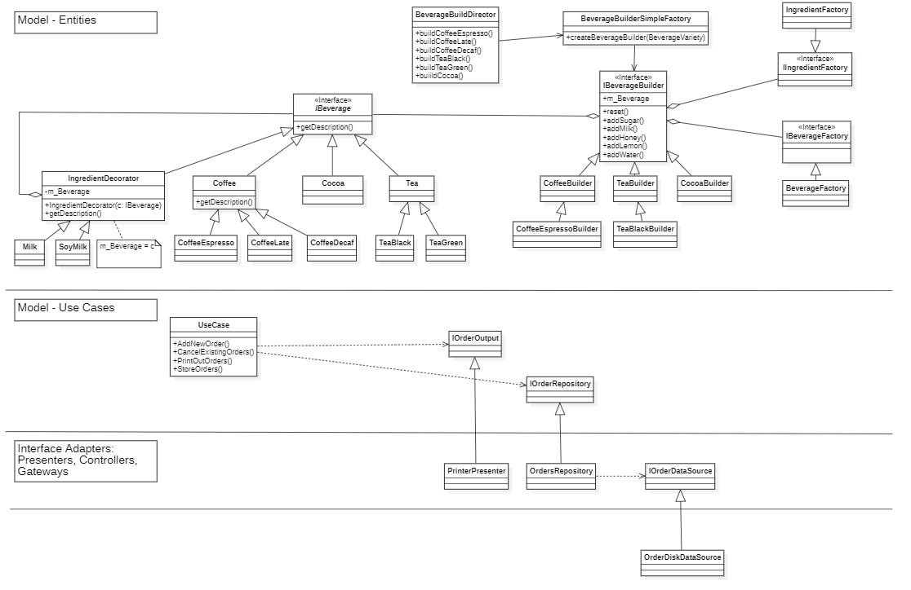


# Folder structure

```
/
├── cmake
│   ├── CompilerWarnings.cmake
│   ├── GenerateAndInstallConfig.cmake
│   ├── InterviewPracticeQuestionsConfig.cmake.in
│   ├── ProjectOptions.cmake
│   ├── StandardProjectSettings.cmake
│   ├── StaticAnalysers.cmake
│   ├── FindGit.cmake
│   ├── git_revision.cmake
│   └── safeguards.cmake
├── include
│   ├── Domain
│   │   ├── Entities
│   │   └── DomainEvents
│   ├── Application
│   │   ├── UseCases
│   │   ├── ApplicationServices
│   │   └── DTOs
│   ├── InterfaceAdapters
│   │   ├── Controllers
│   │   ├── Presenters
│   │   └── Gateways
│   └── Infrastructure
│       ├── UI
│       ├── DB
│       ├── Devices
│       └── Web
├── src
│   ├── Domain
│   ├── Application
│   ├── InterfaceAdapters
│   ├── Infrastructure
│   │   ├── UI
│   │   ├── DB
│   │   └── Devices
│   └── CMakeLists.txt
├── libs
│   ├── googletest
│   └── CMakeLists.txt
├── tests
│   ├── UnitTests
│   │   ├── unitest.cpp
│   │   └── CMakeLists.txt
│   ├── IntegrationTests
│   │   ├── integrationest.cpp
│   │   └── CMakeLists.txt
│   └── CMakeLists.txt
├── apps
│   ├── ConsoleApp
│   │   ├── main.cpp
│   │   └── CMakeLists.txt
│   └── CMakeLists.txt
├── deploy
│   └── .gitkeep
├── scripts
│   └── helper.py
├── docs
│   ├── doxygen
│   │   └── doxyfile.in
│   ├── images
│   │   └── MainClassDiagram.png
│   ├── README_development.txt
│   └── CMakeLists.txt
├── .clang-format
├── .clang-tidy
├── .cmakelintrc
├── .gersemirc
├── .gitattributes
├── .gitignore
├── .pre-commit-config.yaml
├── README.md
├── LICENSE.md
├── conanfile.txt
├── CMakeLists.txt
└── CMakeUserPresets.json

```

# System architecture



