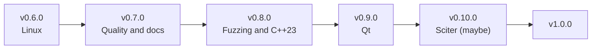

# Roadmap

The overall plan: why the project exists, the order of the versions, and the decisions that don't
fit in an issue. For the rest:

- **What is being done:** the [milestones and issues](https://github.com/joset15/CoffeeShop/milestones)
  on GitHub. They are the only place with the scope and status of each pull request, so this file
  doesn't repeat them.
- **What is done:** [`CHANGELOG.md`](../CHANGELOG.md).

`AGENTS.md` ("Planning") explains how they work together.

## Goals

CoffeeShop demonstrates Clean Architecture and multiplatform modern C++, with quality:

- it builds and is tested on Windows and Linux;
- it follows the C++ standard: C++20 today, C++23 next;
- it has several frontends next to `apps/ConsoleApp` that reuse the same layers;
- features are added only when strictly necessary: the value is in the architecture, not in the
  business rules.

## Versions

Each version has a milestone on GitHub with the same name. See "Versions and releases" in
`AGENTS.md` for the numbering.

| Version | Goal | Needs |
|---|---|---|
| `v0.6.0` | Linux: gcc build, tests, coverage and sanitizers, locally and in the CI | |
| `v0.7.0` | Visible quality and developer documentation: GitHub apps, README badges, README and Doxygen | `v0.6.0` |
| `v0.8.0` | Fuzzing and C++23 | `v0.6.0` |
| `v0.9.0` | Qt frontend | `v0.6.0`, and preferably `v0.8.0` |
| `v0.10.0` | Sciter frontend, if it is still worth doing after Qt | `v0.9.0` |
| `v1.0.0` | Multiplatform, with its frontends | the above |

## Decisions

### Linux

- MemorySanitizer is not planned: everything would have to be instrumented, for little value.
  ThreadSanitizer only if a frontend adds threads.

### Quality and documentation

- It comes after Linux so that the coverage badge and the developer documentation cover both
  platforms from the start.
- Decide first whether the repository becomes public, because that decides which services are free
  and whether their badges work. Then choose them.
- Measure DeepSource against the project's clang-tidy checks before keeping it, and do the same with
  any other analyzer: keep it only if it finds what clang-tidy doesn't.
- Badges show real data from the CI or a service. Don't add badges with fixed values.
- Developer documentation: review the README and `docs/README_development.md`, and try `BUILD_DOC`
  (Doxygen).
- Publish the Doxygen site from the CI, on GitHub Pages: the owner's plan offers it for this private
  repository. Check first whether the site would be visible to everyone. CodeDocs is the alternative
  if the repository becomes public.
- Measure the documentation coverage with Coverxygen on the public API, and show it as a badge. A
  badge from a Gist and shields.io also works in a private repository, for this and for the test
  coverage, but the Gist's figures are public.

### Fuzzing and C++23

- Fuzzing comes after Linux, because the candidates need clang. Compare FuzzTest, libFuzzer and
  RapidCheck before choosing, and always run it with ASan and UBSan.
- The first targets are the `ConsoleMenu` parsing (no crash on any input) and the director's rules
  (properties).
- C++23 comes after Linux so that every feature is checked on MSVC and gcc.
- With C++23, `OrderRepository::describeOrders()` and its test double (`FakeOrderRepository`) can
  build the vector with `std::views::transform` and `std::ranges::to` instead of a raw loop: cppcheck
  suggested it (`useStlAlgorithm`), and with C++20's `std::ranges::transform` it isn't clearer.

### Frontends

- Each frontend is a new CMake app under `apps/`, with its UI in Infrastructure and its presenters
  in InterfaceAdapters. The legacy Qt files are replaced, not patched.
- Choose between Qt Widgets and QML when planning `v0.9.0`.

### CI and services

- The repository stays private for now, so the runs use the plan's monthly Actions credit, and a
  Windows minute costs more than a Linux one: think of the cost before adding jobs.
- Codecov is parked until `v0.7.0`: for now, the coverage is shown in the job summary.

## Ideas

Not planned yet. An idea gets an issue and a milestone when it is scheduled.

- More UIs and platforms, see [the analysis](analysis/ui-and-platforms.md): a text-based UI, a UI for
  IoT and low-power devices, macOS and Android.
- A workflow that publishes the GitHub Release when a tag is pushed.
- Migrate to Conan 2, which also allows GoogleTest 1.16 or later. Postponed because the owner still
  uses Conan 1 in other projects.
- `std::span<const Ingredient>` instead of `const std::vector<Ingredient> &` in the signatures that
  take ingredients.
- `static_assert` that the `ConsoleMenu` tables cover every value of their enum.
- Store orders on disk (very low priority, see "Gotchas" in `AGENTS.md`).
- Remove the `BeverageBuildDirector_Test` cases that repeat rows of the rules table.
- One presenter per use case (`AddNewOrderPresenter`, ...), as in Robert C. Martin's examples, instead
  of one `TextPresenter` that implements every output port. Worth it if a presenter grows or needs
  its own state.
- Precompiled headers aren't used: `BUILD_USING_PCH` is `OFF` in every preset and in the CI, because
  it can't be combined with clang-tidy. Add a preset without clang-tidy and with precompiled headers
  (as `Windows x64 Debug ASan` is without clang-tidy), with a precompiled header for the tests that
  includes `<gtest/gtest.h>` (they reuse `include/pch.h`, which doesn't). Measure the gain first.
- Mark the leaf classes `final` (concrete builders, ingredient decorators) to say that they aren't
  meant to be derived from. gcc's `-Wsuggest-final-*` points at some of them, but it was left out
  because it also points at classes that have subclasses.
